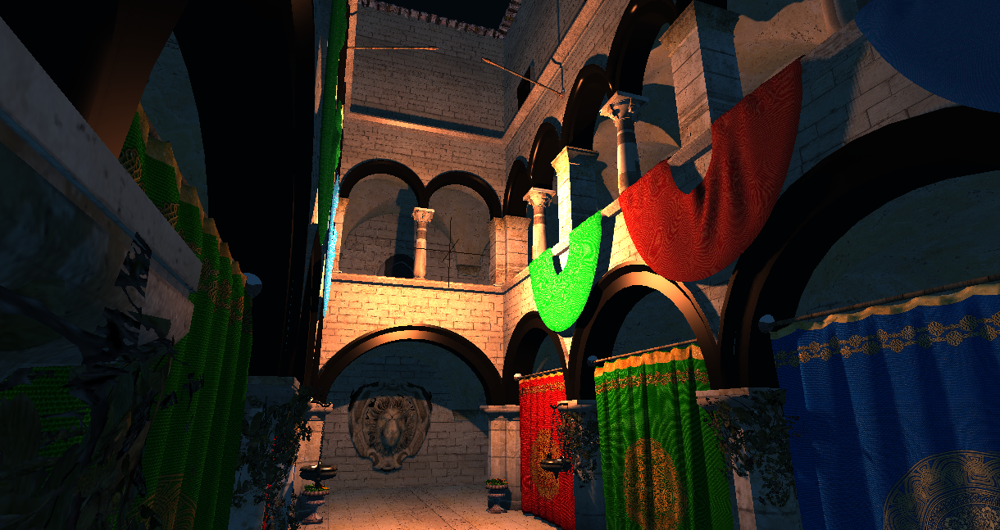

# Homework 2: Scene Renderer

A small WebGPU renderer for textured OBJ scenes. It demonstrates Phong lighting, a moving sun, a moving point light, and soft shadows from both lights.



## Features

- OBJ and MTL loading with multiple materials and submeshes
- Albedo and transparency textures
- Ambient, directional, and point-light Phong lighting
- VSM shadow mapping with separable blur
- Directional shadow projection fitted to the camera frustum
- Six-face cubemap shadows for the point light
- First-person camera controls

The included `homework/sponza` directory contains the Crytek Sponza test scene.

## Requirements

- CMake 3.20 or newer
- C++20 compiler
- SDL3 development package
- wgpu-native v29.0.1.1

## Build

Configure the project from the repository root. Set `WGPU_NATIVE_ROOT` to the directory containing the wgpu-native `include` and `lib` directories. Set `CMAKE_PREFIX_PATH` if CMake cannot find SDL3.

```sh
cmake -S . -B build \
  -DWGPU_NATIVE_ROOT=/path/to/wgpu-native \
  -DCMAKE_PREFIX_PATH=/path/to/SDL3
cmake --build build
```

## Run

Pass an OBJ file as the only argument:

```sh
./build/homework/homework2 homework/sponza/sponza.obj
```

On Windows, place the SDL3 and wgpu-native runtime libraries beside the executable if they are not already available on `PATH`.

## Controls

- `W`, `A`, `S`, `D` — move the camera
- Mouse — look around
- `Left Shift` — move faster
- `Space` — pause or resume light animation
- `Escape` — exit
